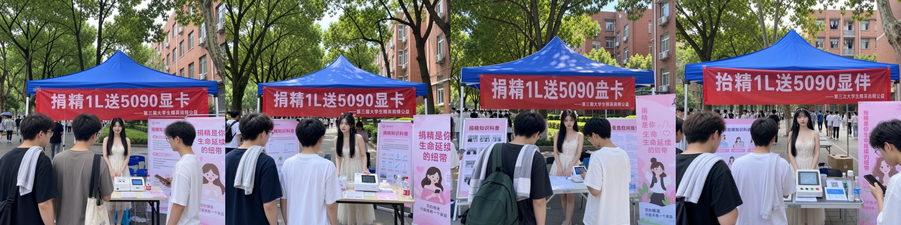

# 各档位出图效果与速度评测

固定随机种子与生成参数，对比官方 9B 原生模型与各学生档位（0.8B / 2B / 4B）在 10 条提示词下的实际出图表现、特征相似度与运行耗时。

## 口径

| 项 | 值 |
|---|---|
| 出图模型 | `moss_image_sft_int8_convrot.safetensors`（int8） |
| VAE | `flux2-vae_small.safetensors` |
| 加速 | `MOSS-Image-SFT-4-steps.safetensors`，strength 1.0 |
| 采样 | 4 步，cfg 1.0，euler / sgm_uniform，seed 42 |
| 分辨率 | 1024×1024，`EmptyFlux2LatentImage` |
| 引导 | `SkipLayerGuidanceDiTSimple`，single_layers 22 |
| 硬件 | RTX 4060 Laptop 8 GB / i9-12900HX / 32 GB |

测试档位包括 9B 教师（基准）与 7 个学生档位（0.8B / 2B 各 bf16、int8、w4a8，4B 包含 w4a8）。

## 提示词

共 10 条测试提示词，逐字输入编码器（编号与出图文件名 `01`~`10` 对应，括号内为 token 数）：

> 第 10 条取自常见排版测试用例，仅用于检验 627 token 的 JSON 解析与多目标排版渲染。

**1 · 基础能力（30 token）**

```
一只戴着草帽的橘猫坐在窗台上，背景是樱花，水彩风格，柔和光线
```

**2 · 专名（只给名字，25 token）**

```
蔚蓝档案的鬼方カヨコ蹲在巷子里喂流浪猫
```

**3 · 专名 + 外观（45 token）**

```
蔚蓝档案的鬼方カヨコ，黑长发、白色挑染、红瞳的少女，穿黑色制服，蹲在巷子里喂流浪猫，二次元插画风格
```

**4 · 世界知识（只给名字，19 token）**

```
蜜雪冰城的雪王站在店门口
```

**5 · 世界知识 + 外观（36 token）**

```
蜜雪冰城的雪王，白色雪人吉祥物，圆身，红围巾，金冠，火炬，站在奶茶店门口
```

**6 · 中文短文本（33 token）**

```
一块木牌上用楷书写着「猫娘咖啡」四个字，牌子挂在咖啡馆门口，白天，写实风格
```

**7 · 多格布局 + 指定台词（130 token）**

```
四格漫画，2x2 布局，主角是橘色头发的猫娘，穿女仆装。日式漫画风格，黑白线稿，每格有边框，每格都带白色对话气泡并写中文字：
第一格：她在揉面团，气泡写「今天一定要成功！」
第二格：烤箱冒烟，她惊讶，气泡写「咦？怎么冒烟了？」
第三格：她脸上沾满面粉很沮丧，气泡写「呜呜，又是这样……」
第四格：她端出焦黑的蛋糕但很开心，气泡写「焦了，但味道还行！」
```

**8 · 品牌 logo（不给外观，41 token）**

```
生成 DeepSeek 官方 logo，纯白背景，居中构图，扁平矢量风格，图形下方是黑色无衬线英文「deepseek」字样
```

**9 · 年代质感（84 token）**

```
2000 年的实拍照片：傍晚的老城区街道，几个穿宽腿牛仔裤和宽松短袖的年轻人在小卖部门口合影，背景有砖墙、老式自行车和电线杆，4:3 横幅构图，柯达胶卷质感，轻微颗粒与偏黄偏绿偏色，闪光灯直打成片，业余摄影随手拍的构图
```

**10 · 长结构化 JSON（627 token）**

```json
{"width":1280,"height":960,"bbox_coord_space":"abs","bbox_format":"xyxy","summary":{"meta":["smartphone photo","candid snapshot","campus street event"],"canvas":"single","caption":"阴天的老校区小路，浓密树荫下搭着蓝色遮阳帐篷，背景是红褐色砖墙宿舍楼，帐篷下是宣传摊位：上方一条红色横幅，中央一位黑长直女性站在折叠桌后，左右各立一块粉色宣传展板，前景两名男生背对镜头咨询，桌上放着白色检测仪器","palette":["#b81f22","#e8c8d8","#4a6a5a","#8a8175"]},"items":[{"label":"text","caption":"红色横幅，白色粗体大字","text":"捐精1L送5090显卡","bbox":[200,20,1180,175]},{"label":"text","caption":"横幅右下角的小字副标题","text":"——第三届大学生精英捐精公益","bbox":[400,178,1150,232]},{"label":"character","caption":"黑长直发年轻女性，金色发饰，白色蕾丝吊带连衣裙，站姿，面朝镜头","bbox":[480,340,800,960]},{"label":"object","caption":"左侧粉色宣传展板，白色边框","bbox":[30,300,430,700]},{"label":"text","caption":"左侧展板顶部的黑色标题，横排","text":"捐精知识科普","bbox":[240,310,420,348]},{"label":"object","caption":"右侧粉色竖版宣传海报，卡通女性插画","bbox":[970,330,1280,900]},{"label":"text","caption":"右侧海报上的竖排粉色标题","text":"捐精是你\n生命延续\n的纽带","bbox":[1000,360,1190,520]},{"label":"text","caption":"右侧海报副文案","text":"您的精液\n可能挽救一个家庭","bbox":[1000,530,1210,620]},{"label":"character","caption":"左侧年轻男生，背影，深色短袖，肩搭灰白毛巾，戴眼镜","bbox":[0,470,330,960]},{"label":"character","caption":"右侧年轻男生，侧脸，白色T恤，戴眼镜，低头看手机","bbox":[760,460,1050,960]},{"label":"object","caption":"折叠桌，白色检测仪器带小屏，散着传单与矿泉水瓶","bbox":[330,700,620,900]}]}
```

## 出图矩阵

每档 10 张图，按提示编号 01~10 排列（五列两行）。

| 档位 | 整档缩略 |
|---|---|
| 9B w4a8（基准） |  |
| 4B w4a8 |  |
| 2B bf16 |  |
| 2B int8 |  |
| 2B w4a8 |  |
| 0.8B bf16 |  |
| 0.8B int8 |  |
| 0.8B w4a8 |  |

### 关键提示的四档对比（9B / 4B / 2B w4a8 / 0.8B bf16）

第 2 条（只给角色名「蔚蓝档案的鬼方カヨコ蹲在巷子里喂流浪猫」）：


| 档位 | 画成什么 |
|---|---|
| 9B | 白发黑挑染、红瞳、双角、光环、黑外套——角色对 |
| 4B | 有角和光环，但蓝瞳、无挑染——落进「蔚蓝档案」这个域，认错人 |
| 2B | 白发蓝瞳的普通少女，没有角也没有光环，与 0.8B 的区别只是换了发色 |
| 0.8B | 金发蓝眼、白衬衫蓝裙——完全没识别，落回通用萌系 |

第 4 条（只给品牌名「蜜雪冰城的雪王站在店门口」）：


| 档位 | 画成什么 |
|---|---|
| 9B | 招牌「蜜雪冰城」、白胖雪人、金冠、红披风、冰淇淋火炬，身上还有竖排「蜜雪冰城」，全对 |
| 4B | 以上要素齐全，只少了身上的竖排字 |
| 2B | 招牌与金冠正确，但雪人变成了真的雪堆、披风变成红围巾、没有火炬 |
| 0.8B | 招牌写成「𠳨雪冰城」，雪王被画成穿龙袍的白胡子老者 |

第 7 条（四格漫画 + 指定台词）：


第 10 条（627 token 的长 JSON）：



## 条件向量矩阵

逐 token 余弦对教师 9B 计算；`token 间余弦` 是同一段条件里不同 token 之间的平均余弦，越接近教师（0.303）越好：

| 档位 | cos 均值 | cos 最小 | relL2 | 范数比 | token 间余弦 |
|---|---:|---:|---:|---:|---:|
| 9B w4a8 | 1.0000 | 1.0000 | 0.0000 | 1.000 | 0.303 |
| 0.8B bf16 | 0.8149 | 0.7640 | 0.830 | 1.062 | 0.401 |
| 0.8B int8 | 0.8146 | 0.7634 | 0.835 | 1.066 | 0.401 |
| 0.8B w4a8 | 0.8136 | 0.7633 | 0.780 | 1.021 | 0.396 |
| 2B bf16 | 0.8406 | 0.7924 | 0.697 | 1.011 | 0.386 |
| 2B int8 | 0.8405 | 0.7923 | 0.697 | 1.011 | 0.387 |
| 2B w4a8 | 0.8372 | 0.7862 | 0.720 | 1.020 | 0.386 |
| 4B w4a8 | 0.8638 | 0.8099 | 0.537 | 0.934 | 0.368 |

逐条余弦：

| 档位 | 1 | 2 | 3 | 4 | 5 | 6 | 7 | 8 | 9 | 10 |
|---|---:|---:|---:|---:|---:|---:|---:|---:|---:|---:|
| 0.8B bf16 | 0.866 | 0.770 | 0.823 | 0.764 | 0.808 | 0.827 | 0.799 | 0.840 | 0.840 | 0.813 |
| 0.8B int8 | 0.865 | 0.769 | 0.822 | 0.763 | 0.808 | 0.826 | 0.800 | 0.840 | 0.840 | 0.813 |
| 0.8B w4a8 | 0.864 | 0.768 | 0.821 | 0.763 | 0.808 | 0.825 | 0.798 | 0.840 | 0.838 | 0.811 |
| 2B bf16 | 0.886 | 0.792 | 0.848 | 0.796 | 0.831 | 0.850 | 0.834 | 0.862 | 0.872 | 0.835 |
| 2B int8 | 0.886 | 0.792 | 0.847 | 0.796 | 0.831 | 0.851 | 0.834 | 0.861 | 0.872 | 0.834 |
| 2B w4a8 | 0.882 | 0.786 | 0.844 | 0.791 | 0.827 | 0.847 | 0.832 | 0.861 | 0.869 | 0.832 |
| 4B w4a8 | 0.901 | 0.821 | 0.871 | 0.810 | 0.862 | 0.872 | 0.865 | 0.884 | 0.892 | 0.861 |

说明：得分最低的是第 2、4 条（只给名称）。余弦低只说明条件向量偏了，推不出「知识储备少」；真正的证据在出图上——4B 认得作品却认错人，0.8B 完全认不出。

## 耗时

### 纯编码（仅调用文本编码器，不含 ComfyUI 调度与 DiT 采样）

| 档位 | 30 token 耗时 | 吞吐量 | 326 token 耗时 | 吞吐量 |
|---|---:|---:|---:|---:|
| 9B w4a8 | 87.0 ms | 345 tok/s | 130.7 ms | 2,495 tok/s |
| 0.8B bf16 | 47.3 ms | 634 tok/s | 43.4 ms | 7,505 tok/s |
| 0.8B int8 | 57.4 ms | 523 tok/s | 61.0 ms | 5,341 tok/s |
| 0.8B w4a8 | 91.3 ms | 329 tok/s | 76.8 ms | 4,244 tok/s |
| 2B bf16 | 43.1 ms | 696 tok/s | 44.8 ms | 7,280 tok/s |
| 2B int8 | 49.1 ms | 611 tok/s | 51.5 ms | 6,325 tok/s |
| 2B w4a8 | 72.9 ms | 412 tok/s | 71.1 ms | 4,583 tok/s |
| 4B w4a8 | 87.9 ms | 341 tok/s | 86.9 ms | 3,750 tok/s |

- 短序列（30 token）下计算耗时受固定调用开销影响较大，长序列（326 token）下尺寸差异更为明显；
- w4a8 量化因每层需执行反量化，在小模型纯编码阶段比 bf16 耗时略高。

### 端到端耗时（ComfyUI 完整出图流程，含采样与模型切换）

| 档位 | 冷态首次 | 热态中位数 | 热态最快 |
|---|---:|---:|---:|
| 9B w4a8 | 55.7s | 33.1s | 29.7s |
| 4B w4a8 | 33.3s | 23.6s | 23.1s |
| 2B bf16 | 26.0s | 21.7s | 21.3s |
| 2B int8 | 24.4s | 21.0s | 20.2s |
| 2B w4a8 | 26.3s | 20.4s | 20.0s |
| 0.8B bf16 | 24.6s | 20.3s | 19.3s |
| 0.8B int8 | 23.9s | 22.2s | 20.9s |
| 0.8B w4a8 | 45.5s | 20.9s | 19.8s |

在 8GB 显存设备上，端到端耗时中约 14 秒用于 4 步采样，1 秒用于 VAE 解码，其余时间主要为文本编码器与 DiT 模型在显存中的换入换出开销。小模型体积显著减小，模型加载时间大幅减少，因此端到端整体生成速度明显加快。

## 结论

1. **端到端加速主要源于模型加载开销减少**：纯编码耗时仅占总流程的一小部分，小模型减少了模型在显存中的传输耗时，9B 替换为 0.8B 每张图节省约 12.8 秒，替换为 4B 节省约 9.5 秒。
2. **量化档位生成质量基本一致**：同尺寸下 int8、w4a8 与 bf16 余弦差异在 0.001~0.003，肉眼生成效果差异极小，w4a8 档位可显著降低显存占用。
3. **4B w4a8 效果最接近 9B**：长 JSON 排版的主横幅、副标题及展板文字均完整正确，细节表现接近官方 9B。
4. **专名识别随尺寸退化**：只给名称时，9B 画对了，4B 和 2B 会认错同作品的其他角色，0.8B 基本认不出。
5. **0.8B 在复杂字形上存在偶发偏差**：在 627 token 的长 JSON 中，0.8B 出现部分汉字部件偏离；中短句生成中未出现该问题。
6. **余弦相似度不能完全对应最终画质**：余弦能反映文本特征的偏离程度，但数值高低不能作为图像质量的绝对判定标准。

## 复现

出图流程使用 ComfyUI 与 `MossCLIPLoader` 节点，按上述「口径」表配置参数即可复现对应的出图结果与耗时。节点使用方法见 [comfyui-node.md](comfyui-node.md)。
